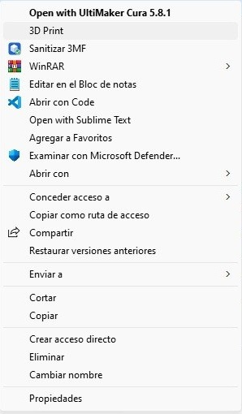
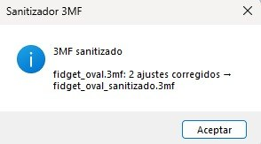

# Sanitizador 3MF para el menú contextual

[English instructions](README.md)

Esta herramienta independiente corrige los ajustes `raft_first_layer_expansion`
y `tree_support_wall_count` cuando valen `-1`. No necesita abrir el slicer y no
sustituye a la aplicación original que vigila carpetas.

Por defecto crea **una copia nueva** junto al archivo original. Por ejemplo,
`modelo.3mf` produce `modelo_sanitizado.3mf`. El original no se modifica, no se
sobrescribe una copia existente y, si no hay nada que corregir, no se crea otra.

## Windows 10 y 11

El ejecutable incluido es para Windows de 64 bits. No necesita Python ni
permisos de administrador.

### Instalación

1. Abre [Sanitizador3MF.exe](windows/prebuilt/Sanitizador3MF.exe) y pulsa
   **Download raw file** en GitHub para descargarlo.
2. Abre el archivo descargado. Windows puede advertir que el ejecutable no está
   firmado; comprueba que procede del repositorio esperado antes de decidir si
   deseas ejecutarlo.
3. Cuando pregunte si quieres añadir **Sanitizar 3MF** al menú contextual,
   pulsa **Sí** y espera la confirmación.
4. El programa guarda una copia para tu usuario en
   `%LOCALAPPDATA%\Programs\Sanitizador3MF`. Ya no necesitas abrir el instalador
   cada vez.

### Uso

1. Abre el Explorador de archivos y busca el `.3mf` que quieres corregir.
2. Haz clic derecho sobre el archivo. En Windows 10 elige **Sanitizar 3MF**. En
   Windows 11 entra primero en **Mostrar más opciones** y después selecciona
   **Sanitizar 3MF**; puede aparecer directamente si ya usas el menú clásico.
3. Lee el mensaje de resultado. Si se han realizado correcciones, abre el
   archivo nuevo terminado en `_sanitizado.3mf` en tu slicer.




Si el archivo no es válido o la copia de salida ya existe, se muestra un error.
Para repetir el proceso, cambia el nombre o mueve la copia existente. Si
seleccionas varios archivos, se procesan por separado.

### Desinstalación

En Windows, abre **Configuración > Aplicaciones**, selecciona
**Sanitizador 3MF** y desinstálalo. También puedes abrir de nuevo el instalador
y elegir la opción de desinstalar. Si el ejecutable instalado está en uso, el
mensaje indica dónde borrarlo después de cerrar la ventana.

## Ubuntu con Archivos (Nautilus)

Necesitas Python 3.10 o posterior y el gestor de archivos Nautilus. La
instalación es para tu usuario y no necesita `sudo`. Para ver los resultados en
el escritorio debe estar disponible `notify-send` o `zenity`.

### Descarga e instalación

1. En la página del repositorio, selecciona la rama que contiene este cambio.
   Pulsa **Code > Download ZIP** y extrae el ZIP en Archivos. También puedes
   clonar la rama de esta propuesta mientras esté pendiente:

   ```sh
   git clone --branch feature/context-menu-sanitizer https://github.com/mvisions/3mf-Sanitizer.git
   ```

2. Abre un terminal dentro de la carpeta extraída o clonada e instala:

   ```sh
   cd context-menu/linux
   bash install.sh
   ```

3. Sin `python3-nautilus`, la opción aparece dentro de **Scripts**. Si quieres
   verla directamente en el menú, instala el paquete, vuelve a ejecutar el
   instalador y reinicia Archivos:

   ```sh
   sudo apt install python3-nautilus
   bash install.sh
   nautilus -q
   ```

   Los dos últimos comandos suponen que el terminal sigue dentro de
   `context-menu/linux`. Reiniciar Nautilus cierra las ventanas de Archivos;
   vuelve a abrirlas después. La instalación del paquete puede pedir tu
   contraseña del sistema.

### Uso

1. En Archivos, haz clic derecho sobre un `.3mf` local.
2. Elige **Sanitizar 3MF**, o **Scripts > Sanitizar 3MF** si no has instalado la
   extensión del menú directo. El menú directo también admite seleccionar
   varios archivos 3MF locales.
3. Consulta la notificación y abre la copia terminada en `_sanitizado.3mf` en
   tu slicer. Si no hace falta corregir nada, no se crea ninguna copia.

Si no aparece la opción, comprueba que usas Nautilus y vuelve a instalar. Para
el menú directo, comprueba que `python3-nautilus` está instalado y reinicia
Archivos. Si la copia de salida ya existe, cámbiale el nombre o muévela antes
de volver a intentarlo.

### Uso desde el terminal

Desde `context-menu/linux`, por ejemplo:

```sh
./sanitize_3mf.py "/ruta/al/modelo.3mf"
./sanitize_3mf.py "/ruta/al/modelo.3mf" --output "/ruta/al/corregido.3mf"
./sanitize_3mf.py --help
```

Por defecto se conserva el original. La opción `--in-place` lo sobrescribe y
crea `modelo.3mf.bak`; una copia de seguridad anterior con ese nombre puede
sobrescribirse. Úsala solo si quieres modificar el original.

### Desinstalación

Desde `context-menu/linux`, ejecuta:

```sh
bash uninstall.sh
nautilus -q
```

Vuelve a abrir Archivos después. Esto elimina la herramienta y sus opciones de
menú para tu usuario, pero no tus archivos `.3mf`.

## Compilación y pruebas

Para compilar el ejecutable Windows x64 desde Linux, instala Go 1.27.3 o
posterior y ejecuta `context-menu/windows/build.sh` desde la raíz del
repositorio. El proceso descarga `go-winres` v0.3.3 y las dependencias Go si no
están en caché. Python con Pillow solo es necesario para regenerar el icono.
El resultado es `context-menu/dist/Sanitizador3MF.exe`. El colaborador probó en
Windows el ejecutable incluido; una compilación del código recuperado no es
idéntica byte a byte y no se ha probado en Windows.

Ejecuta cada comando desde la raíz del repositorio en un terminal separado:

```sh
cd context-menu/linux && python3 -m unittest -v
cd context-menu/windows && go test ./...
```
