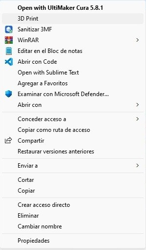
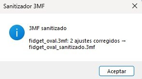

# 3MF context-menu sanitizer

This independent tool fixes `raft_first_layer_expansion` and
`tree_support_wall_count` when their value is `-1`, without running a slicer.
It writes a copy named `<name>_sanitizado.3mf` beside the original. It does
not overwrite an existing output or create a copy if no changes are needed.
The folder-monitoring application remains unchanged.




## Ubuntu (Nautilus)

From `context-menu/linux`, run `./install.sh`. Installation is per-user and
requires Python 3.10 or later. Right-click a 3MF file and select **Scripts >
Sanitizar 3MF**. To show the option directly in the menu instead, install
`python3-nautilus`, rerun `./install.sh` and restart Nautilus with `nautilus -q`.
The direct menu supports selecting multiple local 3MF files.

You can also run `./sanitize_3mf.py model.3mf` from a terminal. See `--help`
for output and in-place options. `./uninstall.sh` removes the per-user files;
restart Nautilus afterward to unload the extension.

## Windows 10 and 11

Download [Sanitizador3MF.exe](windows/prebuilt/Sanitizador3MF.exe), or build it
as described below. Copy it to Windows and run it once to install the per-user
context menu. Right-click a 3MF file and choose
**Sanitizar 3MF**. On Windows 11, use **Show more options** first unless the
classic context menu is already enabled. Each file is processed separately.
Uninstall via Windows Settings > Apps > Sanitizador 3MF, or run the installer
again and choose to uninstall. If the installed executable is running while
uninstalling, the program displays its path for manual removal afterward.

To build the Windows x64 executable on Linux, install Go 1.27.3 or later, then
run `context-menu/windows/build.sh` from the repository root. The build downloads
`go-winres` v0.3.3 and Go module dependencies if they are not cached. Python
with Pillow is only required to regenerate the included icon. The output is
`context-menu/dist/Sanitizador3MF.exe`. The included precompiled executable
was tested on Windows by the contributor; a rebuild from the recovered source
is not byte-identical and has not been tested on Windows.

## Tests

```sh
cd context-menu/linux && python3 -m unittest -v
cd context-menu/windows && go test ./...
```

Run each command from the repository root in a separate shell.
